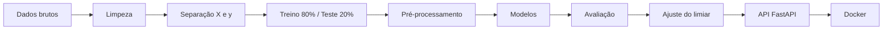
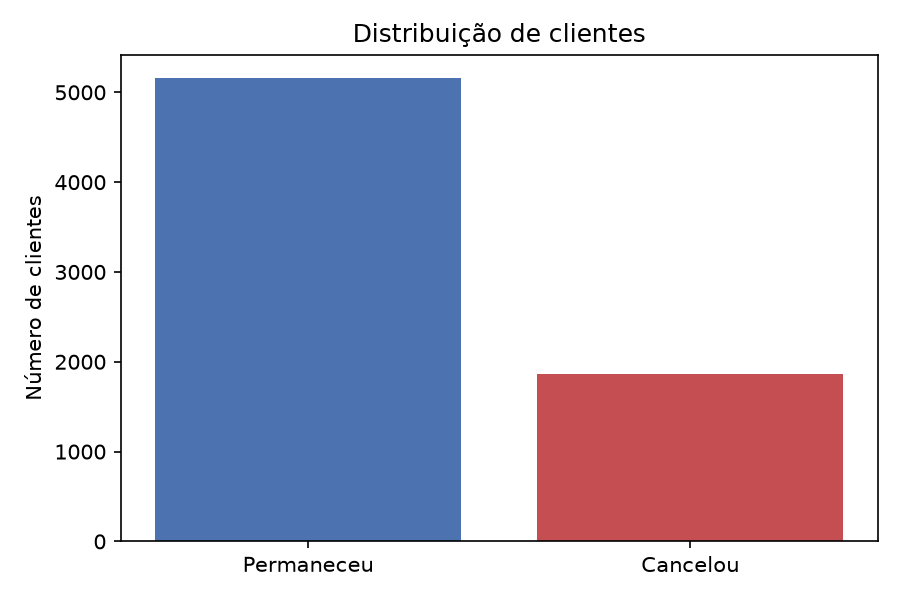
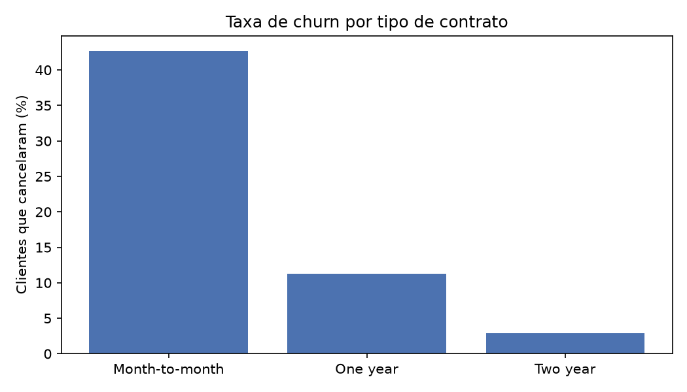
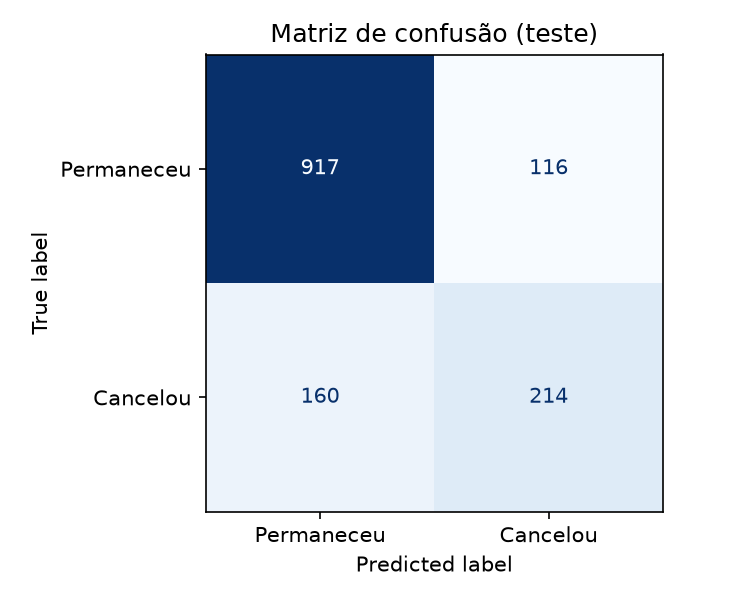

# Previsão de Churn em Telecomunicações


Projeto de ponta a ponta de Machine Learning: análise de dados, modelagem, avaliação, API de previsão com FastAPI e empacotamento com Docker. O objetivo é identificar clientes com alta probabilidade de cancelar o serviço (churn), permitindo ações de retenção antes da perda.

## Sumário

- [Contexto](#contexto)
- [Dados](#dados)
- [Metodologia](#metodologia)
- [Visualizações](#visualizações)
- [Resultados](#resultados)
- [Variáveis mais importantes](#variáveis-mais-importantes)
- [API](#api)
- [Docker](#docker)
- [Como reproduzir](#como-reproduzir)
- [Estrutura do projeto](#estrutura-do-projeto)
- [Limitações e próximos passos](#limitações-e-próximos-passos)
- [Fonte dos dados](#fonte-dos-dados)

## Contexto

Em empresas de assinatura, reter um cliente costuma custar menos do que conquistar um novo. Este projeto prevê o cancelamento a partir do perfil e dos serviços contratados, priorizando a **detecção de quem realmente cancela** (recall da classe positiva) em vez da acurácia geral.

## Dados

Dataset **Telco Customer Churn**, disponibilizado pela IBM. Os dados são fictícios e voltados a fins educacionais.

| Descrição | Valor |
|---|---|
| Clientes (bruto) | 7.043 |
| Variáveis | 21 |
| Clientes após limpeza | 7.032 |
| Taxa de churn | ~26,6% |
| Variável alvo | `Churn` (1 = cancelou, 0 = permaneceu) |

As variáveis incluem perfil do cliente (`SeniorCitizen`, `Partner`, `Dependents`), tempo de relacionamento (`tenure`), serviços contratados, tipo de contrato, forma de pagamento e valores cobrados (`MonthlyCharges`, `TotalCharges`).

## Metodologia



1. **Limpeza:** conversão de `TotalCharges` para numérico, remoção de 11 registros com valor ausente e remoção do identificador `customerID`.
2. **Codificação do alvo:** `Churn` mapeado para 0 e 1.
3. **Divisão:** 80% treino e 20% teste, com `stratify` para manter a proporção de churn nos dois conjuntos e `random_state=42` para reprodutibilidade.
4. **Pré-processamento:** `OneHotEncoder` nas variáveis categóricas e `StandardScaler` nas numéricas, encapsulados em um `Pipeline` do scikit-learn para evitar vazamento de dados entre treino e teste.
5. **Modelos comparados:** Regressão Logística (baseline) e Random Forest com 200 árvores.
6. **Ajuste do limiar de decisão** do melhor modelo, para aumentar a detecção de cancelamentos.

## Visualizações

### Distribuição das classes

<p align="center">
  
</p>

Aproximadamente 1 em cada 4 clientes cancelou, o que caracteriza um problema com classes desbalanceadas.

### Taxa de churn por tipo de contrato

<p align="center">
  
</p>

O tipo de contrato mostra grande diferença na taxa de cancelamento, sendo um forte sinal para o modelo.

### Matriz de confusão

<p align="center">
  
</p>

Matriz do modelo com limiar padrão de 0,5, no conjunto de teste.

## Resultados

Avaliação no conjunto de teste (1.407 clientes, sendo 374 com churn).

### Comparação dos modelos (limiar 0,5, métricas da classe que cancelou)

| Modelo | Recall | Precision | Acurácia |
|---|---|---|---|
| Regressão Logística | 0,57 | 0,65 | 0,80 |
| Random Forest (200 árvores) | 0,50 | 0,62 | 0,79 |

A Regressão Logística superou a Random Forest em recall, precision e acurácia, e foi mantida como modelo principal.

### Ajuste do limiar de decisão (Regressão Logística)

| Limiar | Recall | Precision |
|---|---|---|
| 0,5 | 0,57 | 0,65 |
| 0,4 | 0,68 | 0,58 |
| 0,3 | 0,76 | 0,51 |
| 0,2 | 0,87 | 0,46 |

Com limiar de **0,3**, o recall da classe de churn sobe de 0,57 para **0,76**, com F1 estável em 0,61. O custo é a queda da precision (0,65 para 0,51) e da acurácia geral (0,80 para 0,74).

**Referência:** um classificador que prevê sempre "permanece" atingiria cerca de 73% de acurácia, mas não detectaria nenhum cancelamento. Por isso a avaliação prioriza o recall.

**Decisão de negócio:** a escolha do limiar ideal depende do custo de uma ação de retenção (por exemplo, um desconto) em relação ao custo de perder um cliente. Se a ação é barata e a perda é cara, vale reduzir o limiar. O valor adotado na API é 0,3.

## Variáveis mais importantes

Coeficientes da Regressão Logística (positivo empurra para cancelar, negativo empurra para permanecer):

| Variável | Peso | Efeito |
|---|---|---|
| `tenure` (tempo de casa) | -1,35 | Permanecer |
| Contrato de 2 anos | -0,78 | Permanecer |
| Internet DSL | -0,62 | Permanecer |
| Contrato mensal | +0,61 | Cancelar |
| Internet fibra ótica | +0,59 | Cancelar |

**Leitura:** o perfil de maior risco é o do cliente recente, com contrato mensal e internet por fibra. Clientes antigos e com contratos longos tendem a permanecer.

**Ressalvas:** `TotalCharges`, `MonthlyCharges` e `tenure` são correlacionadas entre si (o total pago é aproximadamente a mensalidade vezes o tempo de casa), então os pesos individuais dessas três variáveis não devem ser interpretados isoladamente. Além disso, os coeficientes indicam associação, não causa.

## API

API construída com **FastAPI** que recebe os dados de um cliente e retorna a probabilidade de cancelamento.

| Método | Rota | Descrição |
|---|---|---|
| GET | `/` | Verifica se a API está no ar |
| POST | `/prever` | Retorna a probabilidade de churn de um cliente |
| GET | `/docs` | Documentação interativa (Swagger) |

Exemplo de requisição para `POST /prever`:

```json
{
  "gender": "Female",
  "SeniorCitizen": 0,
  "Partner": "No",
  "Dependents": "No",
  "tenure": 2,
  "PhoneService": "Yes",
  "MultipleLines": "No",
  "InternetService": "Fiber optic",
  "OnlineSecurity": "No",
  "OnlineBackup": "No",
  "DeviceProtection": "No",
  "TechSupport": "No",
  "StreamingTV": "Yes",
  "StreamingMovies": "Yes",
  "Contract": "Month-to-month",
  "PaperlessBilling": "Yes",
  "PaymentMethod": "Electronic check",
  "MonthlyCharges": 95.5,
  "TotalCharges": 191.0
}
```

Resposta:

```json
{
  "probabilidade_cancelar": 0.76,
  "vai_cancelar": true,
  "limiar": 0.3
}
```

## Docker

A API pode ser executada em um container, sem instalar dependências localmente.

```bash
docker build -t churn-api .
docker run -p 8000:8000 churn-api
```

Depois, acesse `http://localhost:8000/docs`.

## Como reproduzir

```bash
git clone https://github.com/atararossatti/projeto-churn.git
cd projeto-churn
pip install -r requirements.txt
pip install matplotlib jupyter
jupyter notebook churn.ipynb
```

O notebook baixa o dataset diretamente da fonte, sem necessidade de arquivos locais. Para rodar a API sem Docker:

```bash
uvicorn api.main:app --reload
```

## Estrutura do projeto

```
projeto-churn/
├── api/
│   └── main.py              # API FastAPI
├── images/                  # Gráficos usados no README
├── models/
│   └── modelo_churn.joblib  # Modelo treinado (Pipeline)
├── churn.ipynb              # Análise, treino e avaliação
├── Dockerfile
├── requirements.txt
└── README.md
```

## Limitações e próximos passos

**Limitações**
- O limiar foi avaliado diretamente no conjunto de teste. O ideal é escolhê-lo com validação cruzada, preservando o teste para a avaliação final.
- Os dados são fictícios, então os resultados não representam uma operação real.
- A Random Forest foi testada apenas com os parâmetros padrão, sem ajuste de hiperparâmetros.

**Próximos passos**
- [ ] Validação cruzada para escolher o limiar
- [ ] Testar XGBoost/LightGBM com ajuste de hiperparâmetros
- [ ] Testes automatizados para a API
- [ ] Pipeline de CI no GitHub Actions
- [ ] Publicar a API em um serviço de nuvem

## Fonte dos dados

IBM, *Telco Customer Churn*.