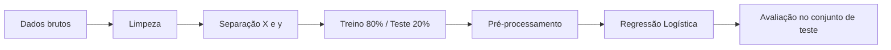

# Previsão de Churn em Telecomunicações

Modelo de classificação para identificar clientes com alta probabilidade de cancelar o serviço (churn), permitindo ações de retenção antes da perda.

## Sumário

- [Contexto](#contexto)
- [Dados](#dados)
- [Metodologia](#metodologia)
- [Visualizações](#visualizações)
- [Resultados](#resultados)
- [Como reproduzir](#como-reproduzir)
- [Próximos passos](#próximos-passos)
- [Fonte dos dados](#fonte-dos-dados)

## Contexto

Em empresas de assinatura, reter um cliente costuma custar menos do que conquistar um novo. O objetivo deste projeto é prever o cancelamento a partir do perfil e do comportamento de contratação do cliente, priorizando a **detecção de quem realmente cancela** (recall da classe positiva) em vez da acurácia geral.

## Dados

Dataset **Telco Customer Churn**, disponibilizado pela IBM. Os dados são fictícios e voltados a fins educacionais.

| Descrição | Valor |
|---|---|
| Clientes (bruto) | 7.043 |
| Variáveis | 21 |
| Clientes após limpeza | 7.032 |
| Taxa de churn | ~26,6% |
| Variável alvo | `Churn` (1 = cancelou, 0 = permaneceu) |

As variáveis incluem perfil do cliente (`SeniorCitizen`, `Partner`, `Dependents`), tempo de relacionamento (`tenure`), serviços contratados, tipo de contrato, forma de pagamento e valores cobrados (`MonthlyCharges`, `TotalCharges`).

## Metodologia

1. **Limpeza:** conversão de `TotalCharges` para numérico, remoção de 11 registros com valor ausente e remoção do identificador `customerID`.
2. **Codificação do alvo:** `Churn` mapeado para 0 e 1.
3. **Divisão:** 80% treino e 20% teste, com `stratify` para manter a proporção de churn nos dois conjuntos e `random_state=42` para reprodutibilidade.
4. **Pré-processamento:** `OneHotEncoder` nas variáveis categóricas e `StandardScaler` nas numéricas, encapsulados em um `Pipeline` do scikit-learn para evitar vazamento de dados entre treino e teste.
5. **Modelo base (baseline):** Regressão Logística.

## Visualizações

### Distribuição das classes

Aproximadamente 1 em cada 4 clientes cancelou, o que caracteriza um